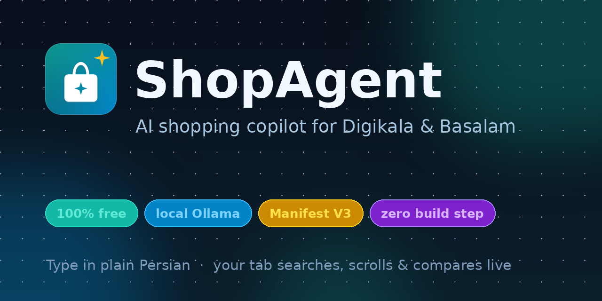

<div align="center">


# 🛍️ خرید‌یار هوشمند · ShopAgent

**دستیار خودکار خرید برای فروشگاه‌های ایرانی — با دستور فارسی، جلوی چشمِ خودت.**
<br/>
*An open-source, automated shopping copilot for Iranian stores — type in plain Persian, watch your tab do the work.*

[](https://developer.chrome.com/docs/extensions/develop/concepts/service-workers)
[](LICENSE)
[](#-بدون-وابستگی--zero-dependencies)
[](#-معماری--architecture)
[](#-هسته-پردازش--the-ai-engine)



**[🇮 فارسی](#-فارسی) · [🇬🇧 English](#-english)**

</div>

---

<!-- ================================================================== -->
<!-- ============================ PERSIAN ============================ -->
<!-- ================================================================== -->

# 🇮🇷 فارسی

> **خرید‌یار هوشمند** یک اکستنشن متن‌باز کروم (Manifest V3) است که دستور طبیعی فارسی تو را می‌گیرد — مثلاً «بهترین ایرپاد تا ۳ میلیون تومان رو پیدا کن» — و تب مرورگرت را **زنده و جلوی چشمت** هدایت می‌کند: در سرچ‌بار تایپ می‌کند، نرم اسکرول می‌کند، قیمت‌ها و مشخصات را می‌خواند، ریال/تومان و اعداد فارسی را نرمال‌سازی می‌کند و در نهایت بهترین گزینه‌ها را با دلیل پیشنهاد می‌دهد.

## ✨ چرا این اکستنشن؟

| ویژگی | توضیح |
|---|---|
| 🧠 **دستور طبیعی فارسی** | «ارزون‌ترین گوشی شیائومی زیر ۸ میلیون» را می‌فهمد: کالا، بازه قیمت، برند، مرتب‌سازی و ویژگی‌ها را استخراج می‌کند. |
| 👀 **اجرای زنده و شفاف** | هیچ کاری پشت پرده نیست: HUD کوچک روی صفحه، حلقه دور المان فعال، و یک «مکان‌نمای شبح» دقیقاً نشان می‌دهد کجا تایپ/کلیک می‌شود. |
| ⌨️ **تایپ انسانی** | شبیه‌سازی رویدادهای واقعی `keydown / keypress / input / keyup` با تاخیر تصادفی چند میلی‌ثانیه‌ای و setter بومی برای ورودی‌های React. |
| 🛡️ **سلکتورهای مقاوم** | هر المان با چند سلکتور معنایی + جست‌وجوی متنی + هیوریستیک ساختاری پیدا می‌شود؛ تغییر جزئی CSS سایت، اکستنشن را نمی‌شکند. |
| 💸 **نرمال‌سازی پول** | `۱,۲۳۴,۵۶۷ تومان`، `1.234.567 ریال`، «۳ میلیون»، «بین ۵۰۰ هزار تا ۲ میلیون» — همه به عدد صحیح تومان تبدیل می‌شوند. |
| 🔌 **هسته رایگان** | پیش‌فرض: **Ollama لوکال**. جایگزین‌ها: کلید رایگان **Groq** یا **Gemini**. و حالت **Built-in**: پارسر قواعدی فارسی بدون هیچ مدلی. |
| 🌗 **UI مدرن** | Side Panel با تم تیره/روشن/خودکار، فونت وزیرمتن، RTL کامل، i18n فارسی⇄انگلیسی و انیمیشن‌های مینیمال. |
| 📦 **بدون وابستگی** | صفر npm، صفر build step. فقط Vanilla JS ماژولار. کل اکستنشن با کشیدن یک پوشه نصب می‌شود. |
| 🔐 **حریم خصوصی** | کلیدهای API فقط در `chrome.storage.local` می‌مانند. هیچ ترکر، هیچ آنالیتیکس، هیچ سرور واسط. |

## ️ فروشگاه‌های پشتیبانی‌شده

- ✅ **دیجی‌کالا** (`digikala.com`)
- ✅ **باسلام** (`basalam.com`)
- 🧪 هر فروشگاه دیگری با موتور هیوریستیک عمومی (آزمایشی)

> ⚠️ سایت‌های فروشگاهی مدام DOM خود را تغییر می‌دهند. اگر روزی سلکتورها جا ماندند، فایل‌های `content/adapters/` تنها جایی هستند که باید لمس شوند — و حتی در بدترین حالت، موتور هیوریستیک و کشف داینامیک دکمه‌ها استخراج را زنده نگه می‌دارد.

---

## 🚀 شروع سریع (۳ دقیقه)

### ۱) نصب Ollama (هستهٔ لوکال و رایگان)

**لینوکس:**

```bash
curl -fsSL https://ollama.com/install.sh | sh
```

**مک (Homebrew):**

```bash
brew install ollama
```

**ویندوز:**
از [ollama.com/download](https://ollama.com/download) نصب‌کننده را بگیر و اجرا کن.

سپس سرور لوکال را روشن کن و یک مدل سبک بکش:

```bash
# سرور لوکال روی http://localhost:11434
ollama serve

# در یک ترمینال دیگر — یکی از این‌ها را انتخاب کن:
ollama pull llama3.2        # پیش‌فرض پیشنهادی (~2GB، سریع)
ollama pull qwen2.5:7b      # قوی‌تر، برای درک بهتر دستور فارسی
ollama pull mistral         # جایگزین سبک

# بررسی اینکه همه‌چیز سالم است:
curl http://localhost:11434/api/tags
ollama ps
```

> 💡 **مدلی نداریم و اینترنت هم قطع است؟** مشکلی نیست: در تنظیمات، هسته را روی **«تحلیل‌گر داخلی (بدون مدل)»** بگذار. یک پارسر قواعدی فارسی داخل خود اکستنشن است که قیمت، برند، بازه بودجه و مرتب‌سازی را بدون هیچ مدلی استخراج می‌کند.

### ۲) لود کردن اکستنشن در حالت Developer Mode

1. کد را کلون کن (یا دکمهٔ **Code → Download ZIP**):

   ```bash
   git clone https://github.com/SamRonin/shopagent.git
   cd shopagent
   ```

2. کروم را باز کن و به این آدرس برو:

   ```text
   chrome://extensions
   ```

3. کلید **Developer mode / حالت توسعه‌دهنده** را (گوشهٔ بالای صفحه) **روشن** کن.

4. روی **Load unpacked / بارگذاری بدون بسته‌بندی** کلیک کن و **پوشهٔ `shopagent`** (همان پوشه‌ای که `manifest.json` داخلش است) را انتخاب کن.

5. آیکون 🛍️ را در نوار ابزار **پین** کن. حالا با کلیک روی آیکون (یا `Ctrl+Shift+Y`) پنل کناری باز می‌شود.

6. در پنل، روی **«تست اتصال»** بزن. اگر چراغ سبز شد، آماده‌ای! 🎉

> 🔁 بعد از هر تغییر در کد، در `chrome://extensions` روی آیکون 🔄 (Reload) همان اکستنشن کلیک کن.

### ۳) اولین دستور

در کادر پایین پنل بنویس:

```text
بهترین ایرپاد تا ۳ میلیون تومان رو پیدا کن
```

و `Enter` بزن. حالا نگاه کن: تب دیجی‌کالا باز می‌شود، عبارت **کاراکتر‌به‌کاراکتر** تایپ می‌شود، نتایج اسکرول می‌شوند، و چند ثانیه بعد کارت‌های پیشنهاد با امتیاز و «چرا این گزینه؟» در پنل ظاهر می‌شوند.

---

## ⚙️ تنظیمات: سوییچ بین هسته‌ها

مسیر: آیکون ⚙️ در پنل → بخش **«هسته هوش مصنوعی»**.

| هسته | هزینه | نیاز به اینترنت | نیاز به کلید | نکته |
|---|---|---|---|---|
| **Ollama (لوکال)** — پیش‌فرض | رایگان | ❌ | ❌ | مدل روی کامپیوتر خودت اجرا می‌شود. آفلاین کامل. |
| **Groq** | لایه رایگان | ✅ | ✅ [کلید رایگان](https://console.groq.com/keys) | بسیار سریع؛ پیشنهاد: `llama-3.3-70b-versatile` |
| **Google Gemini** | لایه رایگان | ✅ | ✅ [کلید رایگان](https://aistudio.google.com/app/apikey) | پیشنهاد: `gemini-2.0-flash` |
| **تحلیل‌گر داخلی** | رایگان | ❌ | ❌ | پارسر قواعدی فارسی؛ صفر نصب، صفر مدل. |

- کلیدها **فقط** در `chrome.storage.local` مرورگر خودت ذخیره می‌شوند و مستقیم از سرویس‌ورکر به همان ارائه‌دهنده می‌روند — هیچ سرور واسطی وجود ندارد.
- دکمهٔ **«بارگذاری مجدد مدل‌ها»** لیست مدل‌های نصب‌شدهٔ Ollama (یا موجود در اکانت Groq/Gemini) را می‌خواند و در یک datalist پیشنهاد می‌دهد.
- اگر مدل تنظیم‌شده روی Ollama نصب نباشد، اکستنشن دقیقاً می‌گوید کدام دستور `ollama pull` را بزنی.

### سایر تنظیمات

- 🎨 پوسته: روشن / تیره / خودکار
- 🌐 زبان رابط: فارسی ⇄ انگلیسی (کل لحظه‌ای، بدون رفرش)
- ⌨️ سرعت تایپ انسانی: آهسته / معمولی / سریع
- 👁️ نمایش HUD زنده روی صفحه
- 📜 اسکرول خودکار برای بارگذاری تنبل
- 🐞 لاگ‌های دیباگ

---

## 🏗️ معماری

```text
┌────────────────────────── مرورگر کروم (MV3) ──────────────────────────┐
│                                                                        │
│  ┌───────────────┐   RUN_TASK / PROGRESS / RESULT   ┌───────────────┐  │
│  │  Side Panel   │ ◄──────────────────────────────► │ background.js │  │
│  │  (UI + i18n)  │                                  │ service worker│  │
│  └───────┬───────┘                                  └──────────────┘  │
│          │ chrome.storage                                  │           │
│          │ (تنظیمات، کلیدها، تاریخچه)                       │ fetch     │
│          ▼                                                 ▼           │
│  ┌───────────────┐                            ┌──────────────────────┐  │
│  │ storage.sync  │                            │  هسته LLM (llm.js) │  │
│  │ storage.local │                            │  ollama│groq│gemini │  │
│  └───────────────┘                            │  + fallback قواعدی │  │
│                                               └──────────┬───────────┘  │
│                                                          │ tabs.send…   │
│                                                          ▼              │
│                             ┌────────────────────────────────────────┐  │
│                             │         content.js (Action Executor) │  │
│                             │  تایپ انسانی · اسکرول نرم · استخراج  │  │
│                             │  HUD زنده · حلقه المان · مکان‌نما    │  │
│                             └────────────────────────────────────────┘  │
└────────────────────────────────────────────────────────────────────────┘
```

**گردش یک اجرا:**
`دستور فارسی` → `parseIntent` (مدل یا قواعد) → `resolveTab` (باز/فوکوس تب فروشگاه) → `SEARCH` (تایپ زنده + سابمیت) → `SCROLL` (لود تنبل) → `SORT`/`PRICE_FILTER` (رابط خود سایت، best-effort) → `EXTRACT` (کارت‌ها ← ساختار) → فیلتر بودجه سمت کلاینت → `rankProducts` (امتیازدهی قطعی + بازچینی مدل) → کارت‌ها در پنل.

**قاعدهٔ طلایی مقاومت:** هر المان DOM با چهار لایه پیدا می‌شود: ① سلکتورهای آداپتر ② ویژگی‌های عمومی (`type=search`, `aria-label`, `placeholder`) ③ جست‌وجوی متنی برچسب‌های فارسی ④ امتیازدهی ساختاری (`cardScore`). اگر همه جا ماندند، `heuristicCards` گروه‌های تکرارشوندهٔ هم‌ساختار را بازسازی می‌کند.

### نقشهٔ فایل‌ها

```text
shopagent/
├── manifest.json              # MV3: activeTab, scripting, storage, sidePanel, tabs
├── background.js              # سرویس‌ورکر: ارکستراتور، مسیر پیام‌ها، keep-alive
├── background/
│   └── providers/             # کلاینت‌های مدل با اینترفیس یکنواخت complete({…})
│       ├── index.js           #   رجیستری + fetchWithTimeout + consumeStream
│       ├── ollama.js          #   /api/chat (stream:false و NDJSON) + ping
│       ├── groq.js            #   OpenAI-compatible (SSE)
│       └── gemini.js          #   generateContent / streamGenerateContent (SSE)
├── sidepanel.html             # پوستهٔ UI + اسپرایت SVG
├── sidepanel/
│   ├── sidepanel.css          # دیزاین‌سیستم: توکن‌ها، تم تیره/روشن، RTL/LTR منطقی
│   └── sidepanel.js           # کنترل‌کنندهٔ UI؛ رندر با textContent (ضد XSS)
├── content/
│   ├── content.js             # ارکستراتور نازک: جدول پیام‌ها + ctx + اعتبارسنجی ACT
│   ├── content.css            # لایهٔ زندهٔ روی صفحه (ring, cursor, toast)
│   ├── adapters/              # سلکتورهای اختصاصی هر فروشگاه + کشف دکمهٔ خرید
│   │   ├── digikala.js        #   لیست‌های سلکتور + برچسب‌های فارسی
│   │   ├── basalam.js         #   همان قرارداد برای باسلام
│   │   └── index.js           #   کشف ۶ لایهٔ دکمهٔ «افزودن به سبد» + تأیید
│   └── actions/               # اجرای اکشن‌های DOM (بدون state، ورودی ctx)
│       ├── dom.js             #   دید/کوئی لایه‌ای/متن + waitFor با MutationObserver
│       ├── interact.js        #   تایپ انسانی، سابمیت، اسکرول، سورت، افزودن به سبد
│       ├── extract.js         #   استخراج کارت/قیمت/امتیاز با امتیازدهی شواهد
│       └── hud.js             #   کارت وضعیت، رینگ، کرسر شبح، توست
├── shared/
│   ├── utils.js               # اعداد فارسی، پول ریال/تومان، بودجه، مشابهت، لاگر
│   ├── sites.js               # آداپترهای دیجی‌کالا/باسلام + موتور هیوریستیک
│   ├── llm.js                 # پارسر JSON مقاوم + auto-repair + رتبه‌بندی + استریم
│   ├── act.js                 # قرارداد اکشن‌ها: safe/confirm/blocked (HITL)
│   ├── errors.js              # پیام‌های خطای فارسی/انگلیسیِ راهنما‌محور
│   ├── storage.js             # تنظیمات و کلیدها (sync + local) و تاریخچه
│   ├── locales.js             # دیکشنری fa/en برای سوییچ زبانی درون‌برنامه‌ای
│   └── i18n.js                # لایهٔ ترجمهٔ زمان‌اجرا
├── _locales/{fa,en}/          # رشته‌های خود manifest (chrome.i18n)
├── fonts/                     # وزیرمتن (woff2) — کاملاً لوکال
├── icons/                     # 16/32/48/128
├── scripts/build-assets.py    # تولید آیکون‌ها و بنر (اختیاری)
├── docs/                      # لوگو و social preview
└── README.md
```

### دسترسی‌ها و چرا

| دسترسی | چرا لازم است |
|---|---|
| `activeTab` | اجرای زنده روی تبی که خودت باز کرده‌ای |
| `scripting` | تزریق content script روی تب‌هایی که قبل از نصب اکستنشن باز بودند |
| `storage` | ذخیرهٔ تنظیمات و کلیدها |
| `sidePanel` | رابط کناری |
| `tabs` | پیدا کردن/باز کردن/فوکوس تب فروشگاه و خواندن URL برای تشخیص فروشگاه |

`host_permissions` فقط شامل دو فروشگاه و سه endpoint مدل (`localhost:11434`, `api.groq.com`, `generativelanguage.googleapis.com`) است — نه بیشتر.

---

## 🩺 عیب‌یابی

| مشکل | راه‌حل |
|---|---|
| چراغ هسته قرمز است / «Ollama در دسترس نیست» | ترمینال: `ollama serve` را اجرا کن. بعد در پنل «تست اتصال». |
| «مدل نصب نیست» | دقیقاً همان دستوری که پنل پیشنهاد می‌دهد: `ollama pull <model>` |
| کادر جستجو پیدا نشد | صفحه را یک بار رفرش کن تا content script تزریق شود؛ یا سرعت تایپ را «سریع» بگذار. |
| نتایج خالی است | اسکرول خودکار را روشن کن؛ بعضی grids فقط با اسکرول لود می‌شوند. |
| پنل خالی ماند | `Ctrl+Shift+Y` یا کلیک روی آیکون. اگر نشد، در `chrome://extensions` Reload بزن. |
| می‌خواهم بدون مدل تست کنم | هسته = «تحلیل‌گر داخلی». همه‌چیز آفلاین کار می‌کند. |
| لاگ‌های پر سر و صدا | تنظیمات → «لاگ‌های دیباگ» را روشن کن و کنسول (`F12`) را ببین. |

---

## 🤝 مشارکت

خوشحال می‌شویم! مسیر ساده است:

1. ⭐ به ریپو ستاره بده و آن را Fork کن.
2. یک شاخه بساز: `git checkout -b feat/basalam-filters`
3. تغییراتت را با کامیت‌های کوچک و معنادار ثبت کن (Conventional Commits): `fix(content): tolerate new digikala price markup`
4. قبل از PR: `node scripts/selftest.js` (تست‌های واحد ماژول‌ها)، `node scripts/protocol.test.js` (تست یکپارچگی با chrome استاب‌شده)، `node scripts/validate.js` (بررسی سازگاری بین فایل‌ها) و `node --check` روی فایل‌های JS تغییر یافته + باز کردن اکستنشن و اجرای یک دستور واقعی.
5. Pull Request باز کن و بنویس **چه چیزی**، **چرا**، و **چطور تستش کردی**.

**ایده‌های خوب برای شروع:**
- آداپتر فروشگاه جدید (تخفیفستان، تیمچه، اسنپ‌مارکت…) — فقط یک فایل در `content/adapters/` که خودش را در `ShopAgent.sites.register(...)` ثبت می‌کند.
- بهبود پارسر قواعدی فارسی (صفت‌ها، رنگ، سایز).
- تست‌های واحد برای `utils.extractMoney` و `llm.builtinParseIntent`.

جزئیات بیشتر و کدِ رفتار: [CONTRIBUTING.md](CONTRIBUTING.md)

---

## 🔐 حریم خصوصی و امنیت

- **هیچ سرور واسطی نیست.** درخواست‌های مدل مستقیم از مرورگر خودت به ارائه‌دهندهٔ انتخابی می‌روند.
- کلیدها در `chrome.storage.local` می‌مانند و هرگز sync نمی‌شوند؛ در لاگ‌ها هم mask می‌شوند.
- تمام رشته‌های خوانده‌شده از صفحهٔ فروشگاه با `textContent` رندر می‌شوند، نه `innerHTML` — بنابراین markup مخرب یک صفحه نمی‌تواند در پنل اجرا شود.
- اکستنشن هیچ دادهٔ رفتاری جمع‌آوری نمی‌کند؛ تاریخچهٔ جستجو فقط روی دستگاه خودت است.

## 📄 لایسنس

[MIT](LICENSE) — آزاد برای استفاده، تغییر و توزیع.

---
---

<!-- ================================================================== -->
<!-- ============================ ENGLISH ============================ -->
<!-- ================================================================== -->

# 🇬 English

> **ShopAgent** is an open-source Chrome extension (Manifest V3) that takes a natural-language Persian command — e.g. *«find the best AirPods under 3,000,000 Tomans»* — and drives your browser tab **live, in front of you**: it types into the search bar, soft-scrolls, reads prices and specs, normalises Rial/Toman and Persian digits, and finally recommends the best options with reasons.

## ✨ Highlights

- 🧠 **Natural-language Persian intent parsing** — product, budget range, brand, sort order and attributes.
- 👀 **Fully transparent automation** — an on-page HUD, a focus ring on the active element and a ghost cursor show exactly what is being typed or clicked.
- ⌨️ **Human-like typing** — real `keydown / keypress / input / keyup` events with randomised jitter and the native value setter for React-controlled inputs.
- 🛡️ **Resilient selectors** — every element is located through layered semantic selectors → text-label search → structural heuristics, so minor CSS changes on the store don't break the run.
- 💸 **Money normalisation** — `۱,۲۳۴,۵۶۷ تومان`, `1.234.567 ریال`, «3 million», «between 500k and 2M» all resolve to an integer Toman value.
- 🔌 **Free-by-design AI core** — local **Ollama** by default; optional free-tier **Groq** / **Gemini** keys; plus a fully offline **built-in rule-based Persian parser**.
- 🌗 **Modern UI** — side panel with dark/light/auto themes, bundled Vazirmatn font, complete RTL, fa⇄en i18n, minimal animation.
- 📦 **Zero dependencies** — no npm, no build step. Modular vanilla JS; install by loading one folder.
- 🔐 **Privacy first** — API keys stay in `chrome.storage.local`; no trackers, no analytics, no proxy server.

## 🖥️ Supported stores

- ✅ **Digikala** (`digikala.com`)
- ✅ **Basalam** (`basalam.com`)
- 🧪 Any other store via the generic heuristic engine (experimental)

---

## 🚀 Quick start

### 1) Install Ollama (free, local engine)

**Linux:**

```bash
curl -fsSL https://ollama.com/install.sh | sh
```

**macOS (Homebrew):**

```bash
brew install ollama
```

**Windows:** grab the installer from [ollama.com/download](https://ollama.com/download).

Then start the local server and pull a light model:

```bash
# local server on http://localhost:11434
ollama serve

# in another terminal — pick one:
ollama pull llama3.2        # recommended default (~2 GB, fast)
ollama pull qwen2.5:7b      # stronger Persian instruction following
ollama pull mistral         # light alternative

# sanity check:
curl http://localhost:11434/api/tags
ollama ps
```

> 💡 **No model & no internet?** Switch the engine to **“Built-in parser (no model)”** in settings — a rule-based Persian parser that needs nothing installed.

### 2) Load the extension in Developer Mode

1. Clone the repo (or **Code → Download ZIP**):

   ```bash
   git clone https://github.com/SamRonin/shopagent.git
   cd shopagent
   ```

2. Open Chrome and go to:

   ```text
   chrome://extensions
   ```

3. Turn on **Developer mode** (top-right corner).

4. Click **Load unpacked** and select the `shopagent` folder (the one containing `manifest.json`).

5. **Pin** the 🛍️ icon. Clicking it (or pressing `Ctrl+Shift+Y`) opens the side panel.

6. Hit **“Test connection”** in the panel. Green dot = you're ready. 🎉

> 🔁 After editing code, click the 🔄 (Reload) button on the extension card in `chrome://extensions`.

### 3) First command

Type this into the composer and press `Enter`:

```text
بهترین ایرپاد تا ۳ میلیون تومان رو پیدا کن
```

Watch Digikala open, the query being typed character by character, results scrolling in, and ranked product cards appearing in the panel with a match score and a “why this one?” note.

---

## ⚙️ Engine settings

Path: ⚙️ icon in the panel → **“AI engine”**.

| Engine | Cost | Needs internet | Needs key | Note |
|---|---|---|---|---|
| **Ollama (local)** — default | free | ❌ | ❌ | The model runs on your machine. Fully offline. |
| **Groq** | free tier | ✅ | ✅ [free key](https://console.groq.com/keys) | Very fast; try `llama-3.3-70b-versatile` |
| **Google Gemini** | free tier | ✅ | ✅ [free key](https://aistudio.google.com/app/apikey) | Try `gemini-2.0-flash` |
| **Built-in parser** | free | ❌ | ❌ | Rule-based Persian parser; zero install. |

Keys are stored **only** in `chrome.storage.local` and go straight from the service worker to the chosen provider — there is no intermediary server. The **“Reload models”** button lists installed Ollama models (or models available on your Groq/Gemini account) into a datalist, and if a configured Ollama model is missing the panel tells you exactly which `ollama pull` command to run.

Other settings: theme (light/dark/auto), UI language (fa⇄en, live), human typing speed, on-page HUD, lazy-load auto-scroll, debug logs.

---

## 🏗️ Architecture

**One run flows like this:**
`Persian command` → `parseIntent` (model or rules) → `resolveTab` (open/focus the store tab) → `SEARCH` (live typing + submit) → `SCROLL` (lazy loading) → `SORT` / `PRICE_FILTER` (the site's own UI, best-effort) → `EXTRACT` (cards → structured data) → client-side budget guard → `rankProducts` (deterministic scoring + optional model re-rank) → cards in the panel.

**The resilience rule:** every DOM element is located in four layers — ① adapter selectors, ② generic attributes (`type=search`, `aria-label`, `placeholder`), ③ Persian label text search, ④ structural scoring (`cardScore`). If all four miss, `heuristicCards` reconstructs repeated same-shape groups from the raw DOM.

**Key files:** `background.js` (orchestrator, keep-alive) · `background/providers/*` (model clients) · `content/content.js` + `content/actions/*` (Action Executor) · `content/adapters/*` (store selectors) · `shared/llm.js` (robust JSON + auto-repair + ranking + streaming) · `shared/act.js` (action contract) · `shared/errors.js` (Persian error guidance) · `shared/utils.js` (Persian digits & money) · `sidepanel/*` (UI).

**Permissions and why:** `activeTab` (act on the tab you invoked), `scripting` (re-inject into tabs opened before install), `storage` (settings & keys), `sidePanel` (the UI), `tabs` (find/open/focus store tabs and read the URL to detect the store). `host_permissions` cover only the two stores and the three model endpoints — nothing else.

---

## 🩺 Troubleshooting

| Symptom | Fix |
|---|---|
| Engine dot red / “Ollama not reachable” | Run `ollama serve`, then “Test connection”. |
| “Model not installed” | Run exactly the `ollama pull <model>` command the panel suggests. |
| Search box not found | Reload the page so the content script injects; or set typing speed to “fast”. |
| Empty results | Enable auto-scroll; some grids only load on scroll. |
| Panel blank | `Ctrl+Shift+Y` or click the icon; otherwise Reload in `chrome://extensions`. |
| Want to test with no model | Engine = “Built-in parser”. Everything works offline. |
| Verbose logs | Settings → “Debug logs”, then open DevTools (`F12`). |

---

## 🤝 Contributing

Contributions are very welcome:

1. ⭐ Star & fork the repo.
2. Branch: `git checkout -b feat/basalam-filters`
3. Small, meaningful commits (Conventional Commits): `fix(content): tolerate new digikala price markup`
4. Before a PR: run `node scripts/selftest.js` (module unit tests), `node scripts/protocol.test.js` (integration test with a stubbed `chrome`), `node scripts/validate.js` (cross-file consistency) and `node --check` the JS files you touched + load the extension and run one real command.
5. Open a PR describing **what**, **why**, and **how you tested it**.

Good first issues: a new store adapter (one self-registering file in `content/adapters/`), richer Persian rule-based parsing, more `confirm`-level actions in `shared/act.js`, or unit tests for `utils.extractMoney`, `llm.parseJsonLoose` and the provider parsers.

See [CONTRIBUTING.md](CONTRIBUTING.md) for the full guide.

## 🔐 Privacy & security

There is **no intermediary server**: model requests go directly from your browser to the provider you chose. Keys live in `chrome.storage.local` only, are never synced, and are masked in logs. Every string scraped from a store page is rendered with `textContent`, never `innerHTML`, so hostile page markup cannot execute in the panel. No behavioural data is collected; your search history stays on your device.

## 📄 License

[MIT](LICENSE) — free to use, modify and distribute.

---

<div align="center">

ساخته‌شده با ❤️ برای خرید راحت‌تر · *Made with ❤️ for easier shopping*

</div>
